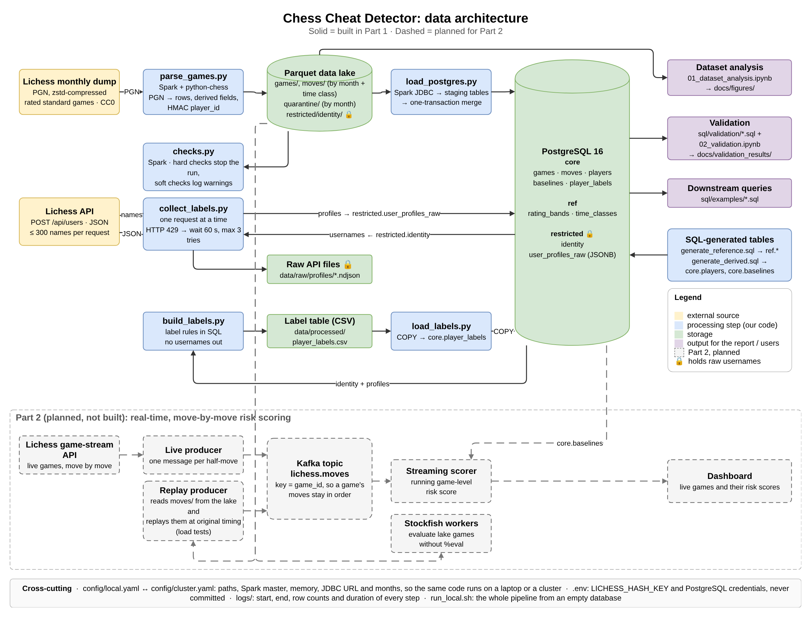

# Chess Cheat Detector

Big Data Technologies, Group Assessment 1 (Part 1).

Online chess platforms regularly close accounts for engine assistance and rating manipulation, and the evidence is in the games themselves: how fast a player moves, how accurate the moves are compared to their rating, and how their results change over time. The long-term goal of this project (Part 2) is a move-by-move cheating risk score for live Lichess games. **Part 1, this deliverable, covers only data generation and ingestion.** It builds a reliable, rerunnable pipeline that takes Lichess open data in three formats (PGN games, JSON user profiles and a CSV label table), plus tables generated in SQL. It loads them into a Parquet data lake and a PostgreSQL 16 database, and validation queries show the data landed correctly and is queryable. Models, Kafka streaming, Stockfish analysis and a dashboard are designed for (dashed lines in the architecture diagram) but not implemented.



## Datasets

| Format | Dataset | Where it ends up |
| --- | --- | --- |
| PGN (source) | Lichess standard rated games, September 2026, first 2,500,000 lines of the monthly dump (124,914 games) | Parquet `games`, `moves`, then `core.games`, `core.moves` |
| JSON | Lichess `/api/users` profile responses, one per player | `data/raw/profiles/*.ndjson` and `restricted.user_profiles_raw` (JSONB) |
| CSV | Player labels (`positive` = flagged by Lichess for a terms-of-service violation, `negative` = active and not flagged, `unknown` = disabled, closed or not returned) | `data/processed/player_labels.csv`, then `core.player_labels` |
| SQL-generated | Reference tables and derived tables | `ref.time_classes`, `ref.rating_bands`, `core.players`, `core.baselines` |

On the sample, the parser produces 124,913 games plus 1 quarantined record (the last game, cut off by the line limit), 8,302,882 moves and 69,392 distinct players.

## Repository structure

```
chess-cheat-detector/
├── README.md
├── SETUP.md                 # local setup, step by step
├── CLAUDE.md                # project decisions, conventions and build order
├── TEAM_TASKS.md            # who built what
├── run_local.sh             # runs the whole pipeline from an empty database
├── requirements.txt
├── .env.example             # template for the secrets file (.env is git-ignored)
├── config/
│   ├── local.yaml           # paths, Spark settings, months, PostgreSQL, Lichess API, quality thresholds
│   └── cluster.yaml         # same keys for the university cluster (values to fill in)
├── src/
│   ├── common/              # config loader, Spark session, logging, player_id hashing
│   ├── ingestion/           # parse_games.py, collect_labels.py, build_labels.py
│   ├── db/                  # load_postgres.py, load_labels.py
│   └── quality/             # checks.py
├── sql/
│   ├── schema.sql           # schemas core, ref, restricted and every table
│   ├── generate_reference.sql
│   ├── generate_derived.sql
│   ├── drop_schemas.sql
│   ├── load/                # staging and merge statements used by load_postgres.py
│   ├── labels/              # label rules used by build_labels.py
│   ├── validation/          # 01_row_counts.sql ... 06_label_coverage.sql
│   └── examples/            # example analytical queries
├── notebooks/
│   ├── 01_dataset_analysis.ipynb   # charts and numbers for the report
│   └── 02_validation.ipynb         # runs the validation queries and saves the results
├── docs/
│   ├── data_dictionary.md
│   ├── diagrams/            # architecture, pipeline and ER diagrams (.drawio + .png)
│   ├── figures/             # charts from notebook 01
│   └── validation_results/  # data quality and validation results
├── data/                    # git-ignored: raw/, lake/, processed/
└── logs/                    # git-ignored
```

## Setup

Follow [SETUP.md](SETUP.md). In short, on a Mac (Apple Silicon, 8 GB RAM):

1. Install Java 17, Python 3.11, zstd and PostgreSQL 16 with Homebrew, and create a database called `chess`.
2. Create a virtual environment and run `pip install -r requirements.txt` (PySpark 3.5.3, pandas 2.x, python-chess, psycopg2).
3. Copy `.env.example` to `.env` and set `LICHESS_HASH_KEY` to a random 64-character hex value (the command is in SETUP.md). The key is used to pseudonymize usernames. With a new key, every `player_id` changes, but all row counts stay the same.
4. Download the sample: the first 2,500,000 lines of the September 2026 Lichess dump, saved as `data/raw/lichess_2026-09_sample.pgn` (about 280 MB).

## Running the pipeline

From the repo root:

```bash
bash run_local.sh                       # uses config/local.yaml
bash run_local.sh path/to/other.yaml    # any config with the same keys
```

**Warning:** the first step drops and recreates the `core`, `ref` and `restricted` schemas, so every run starts from an empty database.

The script activates `.venv`, reads the database settings from the config and `.env`, and runs every step in order. The terminal shows one line per step with its runtime. The full output (Spark included) goes to `logs/run_local_<UTC time>.log`. If a step fails, the script stops, names the step and prints the last 30 lines of the log.

Every Python step runs with `spark-submit`, the same way it would on a cluster:

```bash
PYTHONPATH=. spark-submit --driver-memory 3g --packages org.postgresql:postgresql:42.7.4 \
    src/ingestion/parse_games.py --config config/local.yaml
```

- `PYTHONPATH=.` lets the driver and the Spark workers import the `src` package.
- `--driver-memory 3g` has to be on the command line, because the JVM is already running when the Python code reads the config.
- `--packages` adds the PostgreSQL JDBC driver, which the Spark JDBC load needs (the first run downloads it).

Any single step can be rerun on its own with the same command. Every step is idempotent: a rerun replaces that month's Parquet partitions or PostgreSQL rows instead of adding duplicates, so two runs give identical row counts.

Steps 3 to 5 take about 5 minutes on the sample. The first run also calls the Lichess API for every player (300 usernames per request, one request at a time, waiting 60 s on HTTP 429). The responses are saved in `data/raw/profiles/`, so later runs reuse them instead of calling the API again.

## What each step produces

| Step | Command | Output |
| --- | --- | --- |
| Reset | `sql/drop_schemas.sql` | Empty database (drops `core`, `ref`, `restricted`) |
| Schema | `sql/schema.sql` | Schemas `core`, `ref`, `restricted` and all 9 tables, with primary keys, foreign keys and CHECK constraints |
| Reference tables | `sql/generate_reference.sql` | `ref.time_classes` (6 rows), `ref.rating_bands` (12 rows, built with `generate_series`) |
| 3. Parse games | `src/ingestion/parse_games.py` | Parquet lake in `data/lake/`: `games/` and `moves/` (partitioned by `source_month` and `time_class`), `quarantine/` (games that failed parsing, with the error), `restricted/identity/` (username ↔ `player_id`) |
| 4. Quality checks | `src/quality/checks.py` | `docs/validation_results/dq_parquet.json`. Hard checks (keys, required fields, allowed values) stop the pipeline; soft checks (Elo range, negative move times, games without moves, BOT players) are logged as warnings |
| 5. Load PostgreSQL | `src/db/load_postgres.py` | `core.games`, `core.moves`, `restricted.identity`, loaded with Spark JDBC through staging tables, then row counts checked against Parquet |
| 6. Collect labels | `src/ingestion/collect_labels.py` | `data/raw/profiles/*.ndjson` (JSON source) and `restricted.user_profiles_raw` (raw responses as JSONB) |
| 7a. Build labels | `src/ingestion/build_labels.py` | `data/processed/player_labels.csv` (CSV source, `player_id` only) |
| 7b. Load labels | `src/db/load_labels.py` | `core.player_labels`, loaded with `COPY` |
| 8. Derived tables | `sql/generate_derived.sql` | `core.players` (one row per player), `core.baselines` (move-time statistics per rating band and time class, from human-vs-human games with clocks) |
| 9. Validation | `sql/validation/*.sql` | One PASS / FAIL / WARN / INFO row per check, written to the run log |

Two notebooks are run by hand after the pipeline:

- `notebooks/02_validation.ipynb` runs the validation queries, compares the Parquet and PostgreSQL row counts, and saves `docs/validation_results/validation_results.csv` and `validation_summary.md`.
- `notebooks/01_dataset_analysis.ipynb` produces the charts in `docs/figures/` and the numbers behind them (`dataset_analysis_numbers.csv`).

## Documentation and results

| What | Where |
| --- | --- |
| Data dictionary (every dataset, table and column, the business rules and the data quality checks) | [docs/data_dictionary.md](docs/data_dictionary.md) |
| Architecture, pipeline and ER diagrams | [docs/diagrams/](docs/diagrams/) (`.png` exports; the `.drawio` files can be edited) |
| Data quality results on the Parquet lake | [docs/validation_results/dq_parquet.json](docs/validation_results/dq_parquet.json) |
| Validation results on PostgreSQL | [docs/validation_results/validation_summary.md](docs/validation_results/validation_summary.md) and `validation_results.csv` |
| Example analytical queries and their results | [sql/examples/](sql/examples/), `docs/validation_results/example_*.csv` |
| Dataset analysis charts | [docs/figures/](docs/figures/) |

## Privacy

Lichess usernames are personal data under the GDPR, so the pipeline pseudonymizes them. `player_id` is an HMAC-SHA256 of the lowercase username with a secret key, truncated to 16 hex characters (`src/common/ids.py`). Raw usernames exist only in `data/lake/restricted/`, the PostgreSQL `restricted` schema and `data/raw/profiles/`. They never appear in `core.*`, the CSV, the logs or any committed file. `.env` and `data/` are git-ignored, and the git history has been checked for usernames, data files and secrets.
