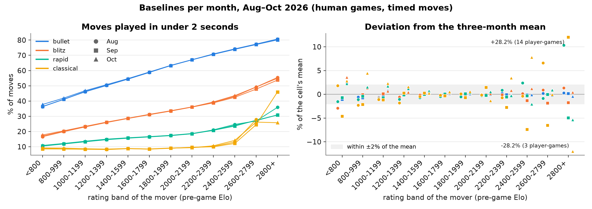

# 8. Data at scale: three months, veracity and integrity

*Draft, Santi, 26 Nov 2026. Numbering follows the master report (Part 1 = chapters 1–6, Part 2 = chapters 7–17). Every number carries an HTML comment with its source file; in tables the source is given once per column, in the header.*

Part 1 proved the pipeline on a sample of 124,913 games <!-- source: docs/figures/dataset_analysis_numbers.csv -->. Part 2 ran the same pipeline, with unchanged parsing rules and quality checks, on three complete Lichess months. This chapter reports what was processed, whether it can be trusted, how it differs from the sample, and how stable the baselines are from month to month. How the work ran on the cluster is the subject of chapter 9.

## 8.1 What was processed

We used the monthly dumps of standard rated games for August, September and October 2026. Each dump was downloaded once to the cluster, accepted only if its SHA-256 matched the checksum Lichess publishes <!-- source: cluster/download.sbatch -->, and parsed in chunks into the Parquet lake (chapter 9). Table X gives the volumes per month.

*Table X. Volumes processed per month (GB = 1024³ bytes)*

| Month | Compressed dump (GB) <!-- source: logs/download-28558.out, logs/download-28557.out, logs/download-28176.out (remote size in bytes); same field as the Content-Length on database.lichess.org, checked 26 Nov 2026: 30,145,862,359 / 29,224,520,887 / 30,982,323,881 bytes, 90,352,707,127 in total --> | Games <!-- source: docs/validation_results/data_at_scale_by_month.csv (games) --> | Moves <!-- source: docs/validation_results/data_at_scale_by_month.csv (moves, from the DQ reports) --> | Players <!-- source: docs/validation_results/data_at_scale_by_month.csv (players; footers of restricted/identity_by_month and restricted/identity) --> | Moves per game <!-- source: computed, moves / games, docs/validation_results/data_at_scale_by_month.csv --> |
|---|---|---|---|---|---|
| Aug 2026 | 28.08 | 91,912,325 | 6,105,818,279 | 1,942,403 | 66.4 |
| Sep 2026 | 27.22 | 89,616,462 | 5,931,407,140 | 1,970,698 | 66.2 |
| Oct 2026 | 28.85 | 95,395,628 | 6,275,657,696 | 2,167,805 | 65.8 |
| **Total** | **84.15** | **276,924,415** | **18,312,883,115** | **3,154,338 distinct** | **66.1** |

The player counts are row counts of the restricted identity tables, read from the Parquet file footers, so no username was loaded. A player appears in 1.9 of the three months on average: the monthly counts add up to 6,080,906 player-months for 3,154,338 distinct players <!-- source: computed from docs/validation_results/data_at_scale_by_month.csv (sum of monthly players / distinct players) -->. No record was quarantined in any month <!-- source: logs/parse-chunked-28560.out, logs/parse-chunked-28559.out, logs/parse-chunked-28226.out (quarantined=0) -->. (The one quarantined record in Part 1 was the sample's truncated last game <!-- source: docs/figures/dataset_analysis_numbers.csv (quarantined records = 1); config/local.yaml (sample_lines) -->.)

After compaction and zstd compression, the lake stores the games in 10,030.4 MB and 131 files, and the moves in 103,215.5 MB and 1,124 files <!-- source: docs/validation_results/partition_compaction.csv (total rows, compacted_zstd) -->, 111.46 GB on disk in total <!-- source: docs/validation_results/partition_compaction.csv (space, games_moves_gb_apparent) -->. That is more than the compressed dumps, because every move becomes a row with its clock, move time and evaluation parsed, but about a sixth of the decompressed PGN (about 210 GB per month <!-- source: cluster/README.md -->). In return the data is fast to use: counting October's 6.3 billion moves by time class takes 2.86 s (median) <!-- source: docs/validation_results/partition_compaction.csv (query, count_moves_by_time_class_median_s) -->. Compaction (from 12,882 files per table <!-- source: docs/validation_results/partition_compaction.csv (total file_count, before) -->) is covered in chapter 9.

## 8.2 Veracity and integrity at full scale

The Part 1 quality module ran on each full month right after parsing. Hard checks fail the job; soft checks log a warning and keep the data. Table X gives every result.

*Table X. Data-quality checks on the full months (violations per check)*

| Check <!-- source: docs/validation_results/dq_full_months.csv (from logs/dq_parquet-28560.json, -28559.json, -28226.json) --> | Level | Aug <!-- source: docs/validation_results/dq_full_months.csv --> | Sep <!-- source: docs/validation_results/dq_full_months.csv --> | Oct <!-- source: docs/validation_results/dq_full_months.csv --> | Result |
|---|---|---|---|---|---|
| `game_id` unique and not null | hard | 0 | 0 | 0 | pass |
| (`game_id`, `ply`) unique | hard | 0 | 0 | 0 | pass |
| Required game columns not null | hard | 0 | 0 | 0 | pass |
| Required move columns not null | hard | 0 | 0 | 0 | pass |
| `result` in the allowed set | hard | 0 | 0 | 0 | pass |
| White and Black are different players | hard | 0 | 0 | 0 | pass |
| Every move belongs to a game | hard | 0 | 0 | 0 | pass |
| `n_plies` = number of move rows | hard | 0 | 0 | 0 | pass |
| Elo outside 400–3500 (games) | soft | 59 | 144 | 10 | warn |
| Move time below −1 s (moves) | soft | 1,846,851 | 1,866,021 | 2,309,678 | warn |
| Games with 0 plies | soft | 170,379 | 256,060 | 407,406 | warn |
| Games without clocks, share (threshold 5%) | soft | 0.28% | 0.38% | 0.52% | pass |
| Games with a BOT player | soft | 407,102 | 434,571 | 494,406 | warn |
| Every player has a label | soft | – | – | – | not applicable at full scale: labels cover a 100k-player sample (chapter 11) |

All eight hard checks pass with zero violations in every month, on about 6 billion move rows per month: keys are unique, nothing required is missing, and every game has exactly as many move rows as plies. The soft warnings describe real features of the data, not parsing errors:

- **BOT games** are 0.44%, 0.48% and 0.52% of games <!-- source: computed, bot_games / games, docs/validation_results/data_at_scale_by_month.csv -->. They are legitimate rated games, so they stay in the lake, flagged with `has_bot`, but are excluded from every feature table and baseline, which describe human play.
- **Games with 0 plies** are 0.19%, 0.29% and 0.43% of games <!-- source: computed, zero_ply_games / games, docs/validation_results/data_at_scale_by_month.csv -->. Most of them end as "Abandoned": 129,606 in August, rising to 363,654 in October <!-- source: docs/validation_results/data_at_scale_zero_ply.csv -->, which explains the growth. With no moves they carry no timing, so features and baselines skip them.
- **Negative move times** below −1 s are 0.030%, 0.031% and 0.037% of moves <!-- source: computed, violations / rows_moves, docs/validation_results/dq_full_months.csv -->, 6,022,550 moves in total <!-- source: docs/validation_results/dq_full_months.csv (sum of move_time_negative) -->. Lichess compensates for network lag, which gives small negative values, and lets the opponent add 15 s to a player's clock, which gives large ones <!-- source: docs/data_dictionary.md §6 (move_time_s) -->. They are kept, and timing statistics use only moves of 0 s or more.
- **Elo outside 400–3500** affects 213 games over the three months, all above 3500 and none below 400 <!-- source: docs/validation_results/data_at_scale_by_month.csv (games_elo_above_3500, games_elo_below_400) -->. 174 of them are bullet games <!-- source: computed, bullet rows of docs/validation_results/data_at_scale_by_month.csv --> and 39 involve a BOT <!-- source: docs/validation_results/data_at_scale_by_month.csv (games_elo_above_3500_with_bot) -->. These are plausible extremes, kept in the 2800+ band.
- **Clock coverage** is 99.72%, 99.62% and 99.48% of games <!-- source: computed, games_with_clock / games, docs/validation_results/data_at_scale_by_month.csv -->, well inside the 5% threshold. Correspondence games (no clock by design) and games with 0 plies account for every game without clocks in August and September, and all but 132 in October <!-- source: computed, (games − games_with_clock) − correspondence − non-correspondence zero_ply_games, docs/validation_results/data_at_scale_by_month.csv -->.
- **Labels** are not checked at full scale. The check expects a label for every player, but labels were collected for a sample of 100,000 players, 80,000 drawn at random and 20,000 from the most anomalous <!-- source: docs/validation_results/labels_summary_cluster.csv (sampled) -->, not for all 3,154,338. Chapter 11 explains the sample.

After these exclusions, the monthly baselines rest on 18,159,674,777 timed moves <!-- source: docs/validation_results/baselines_by_month.csv (sum of n_moves) -->, 99.2% of all moves <!-- source: computed, 18,159,674,777 / 18,312,883,115 (baselines_by_month.csv, data_at_scale_by_month.csv) -->: the exclusions remove noise without thinning the data.

## 8.3 Sample versus full data

The Part 1 sample was the first 2.5 million lines of the September dump <!-- source: config/local.yaml (sample_lines) -->, which covers only the first 101 minutes of 1 September <!-- source: docs/figures/dataset_analysis_numbers.csv (time span) -->. Table X compares it with the full months.

*Table X. Part 1 sample compared with the three full months*

| Measure | Part 1 sample <!-- source: docs/figures/dataset_analysis_numbers.csv; negative move times: docs/data_dictionary.md §6 --> | Aug–Oct 2026 <!-- source: computed from docs/validation_results/data_at_scale_by_month.csv; negative move times: docs/validation_results/dq_full_months.csv; thin cells: docs/validation_results/baselines_by_month.csv --> |
|---|---|---|
| Period | 101 minutes, one night | three complete months |
| Games | 124,913 | 276,924,415 |
| Bullet / blitz / rapid | 35.61% / 46.23% / 16.67% | 35.17% / 45.94% / 17.20% |
| Ultrabullet / classical / correspondence | 0.90% / 0.51% / 0.08% | 0.97% / 0.63% / 0.10% |
| Games with clocks | 99.68% | 99.60% |
| Games with evals | 10.41% | 10.03% |
| Games with a BOT | 0.57% | 0.48% |
| Elo outside 400–3500 | 0 games | 213 games |
| Moves below −1 s | 0.03% | 0.033% |
| Thin baseline cells (under 30) | 12 of 55 cells (players) | 5 of 179 cell-months (player-games) |

The overall shape barely changed: the time-class mix, clock and eval coverage are within a fraction of a percentage point of the sample, so the descriptive findings of Part 1 hold. What changed is depth. Rare events appear (213 games above 3500 Elo, none in the sample), and eval coverage still rises with slower time controls, from 5.86% of bullet games to 31.89% of classical games <!-- source: computed, games_with_eval / games per time class, docs/validation_results/data_at_scale_by_month.csv -->, so engine-based features can only ever cover a minority of games.

The full months remove the two Part 1 limitations that mattered most. First, the sample showed only who plays in the early hours of one night, while the months cover whole days: each monthly dump holds every standard rated game Lichess recorded in that month <!-- source: database.lichess.org (description of the standard dumps) -->, and we parsed each file to its end rather than stopping at a line count as in the sample, so all 24 hours of every day are in the data. Second, 12 of the sample's 55 band × time-class cells had fewer than 30 players <!-- source: docs/figures/dataset_analysis_numbers.csv -->, too few for stable percentiles. In the full months every bullet and blitz cell has at least 9,794 player-games per month <!-- source: docs/validation_results/baselines_by_month.csv (min n_player_games, bullet and blitz) -->. Only five cell-months stay below 30 player-games: classical 2600–2799 in October, classical 2800+ in September and October, and ultrabullet 2800+ in September and October <!-- source: docs/validation_results/baselines_by_month.csv (n_player_games < 30) -->. They are thin because almost nobody plays them, not because of sampling. (The unit is player-games rather than Part 1's players.)

## 8.4 Variability across months

The feedback on Part 1 asked us to measure variability rather than assume it. We computed the provisional baselines (data dictionary L12) separately for each month, with unchanged population and definitions (job 37603): one row per time class, rating band and month, 179 rows <!-- source: docs/validation_results/baselines_by_month.csv (row count) -->. Of the 60 band × time-class cells, 59 have all three months (classical 2800+ has no August row). Figure X shows the share of moves played in under 2 s and each month's distance from the cell's three-month mean.

*Figure X. Share of moves under 2 s per rating band and time class, for each month (left), and each month's deviation from the cell's three-month mean (right). Points beyond ±12% are drawn at the edge and labelled. Ultrabullet is left out; its deviations are below 0.2% except in the 2800+ band. Source: docs/validation_results/baselines_by_month.csv.*

**A caveat on percentiles.** Lichess records clocks in whole seconds, so every move time is a whole number of seconds. All 1,611 percentiles in the table are whole numbers <!-- source: computed, 179 rows × 9 percentile columns of docs/validation_results/baselines_by_month.csv, none fractional -->. A percentile can only move in steps of one second, and at a median of 2 s one step is already a 50% change. In bullet and blitz, the median and the 90th percentile are identical in all three months for all 24 cells <!-- source: docs/validation_results/baselines_by_month.csv (p50_dev_pct and p90_dev_pct = 0 for every bullet and blitz row) -->. In ultrabullet the median move time is 0 s, so its relative deviation is undefined. Identical percentiles therefore mean "less than one second of change", not "no change", so we measure stability with the share of moves under 2 s, which is continuous.

**The share of fast moves is stable.** Of the 179 cell-months, 130 are within ±1% of their cell's three-month mean, 155 within ±2% and 171 within ±5% <!-- source: computed, |share_fast_moves_dev_pct|, docs/validation_results/baselines_by_month.csv -->. The largest deviation in bullet is 2.52% and in blitz 3.60% <!-- source: docs/validation_results/baselines_by_month.csv (max |share_fast_moves_dev_pct| per time class) -->. Large swings occur only in near-empty cells: classical 2800+ moves by ±28.2% on 14 and 3 player-games <!-- source: docs/validation_results/baselines_by_month.csv (classical, band 12) -->. Monthly change is also small next to the gap between neighbouring bands. In August, blitz players rated 1400–1599 played 28.57% of their moves in under 2 s and players rated 1600–1799 played 31.02% <!-- source: docs/validation_results/baselines_by_month.csv (blitz, bands 5 and 6, share_fast_moves) -->, while the 1400–1599 cell itself moves by less than 0.25% between months <!-- source: docs/validation_results/baselines_by_month.csv (blitz, band 5, share_fast_moves_dev_pct) -->.

**There is a small drift at the bottom of the ladder.** October has a higher share of fast moves than August in 40 of the 59 cells <!-- source: computed, share_fast_moves 2026-10 vs 2026-08, docs/validation_results/baselines_by_month.csv -->. The change is clearest in the lowest band: blitz under 800 went from 16.58% to 17.70% and bullet under 800 from 36.27% to 37.72% <!-- source: docs/validation_results/baselines_by_month.csv (band 1, share_fast_moves) -->. The same band grew: blitz player-games under 800 rose from 1,002,449 to 1,240,381 (+23.7%) <!-- source: docs/validation_results/baselines_by_month.csv (blitz, band 1, n_player_games) -->, against 11.6% more players overall <!-- source: computed, players 2026-10 / 2026-08, docs/validation_results/data_at_scale_by_month.csv -->. One possible explanation, which we have not tested, is a change in who plays at the bottom of the ladder rather than faster play by the same people; testing it would mean following the same players from month to month. Rating inflation or deflation cannot be seen directly in baselines that group players by rating; it would need each player's rating history.

For the scorer, baselines pooled over the three months describe each month well, so a score does not depend on the month a game came from, and a monthly refresh is enough to follow the slow drift at the low end.

## 8.5 Value

The value chain starts with 84.15 GB of compressed PGN text <!-- source: logs/download-28558.out, -28557.out, -28176.out -->. The pipeline turns it into a lake of 277 million games and 18.3 billion moves <!-- source: docs/validation_results/data_at_scale_by_month.csv -->, with clocks and evaluations parsed into columns and every row checked. From the lake come timing features for human games and, from those, the baselines per rating band and time class, against which the streaming scorer measures each player after every move. On a full replayed day it scored all 3,055,849 games <!-- source: ~/exports/serving_v2/manifest.json (checks.games_scored) -->. The dashboard turns the scores into a short, ranked review queue (chapter 16). Each step reduces volume and adds meaning, from text nobody can read to a list a reviewer can act on.

## 8.6 Limitations

- Clock resolution is one second, so percentiles cannot show changes below a second; shares and means are used where that matters.
- Three months show stability and a small drift, not seasonality; separating a seasonal effect from a trend needs a longer series.
- Soft warnings stay in the lake by design, so every downstream consumer must apply the same exclusions (BOT games, games with 0 plies, negative move times).
